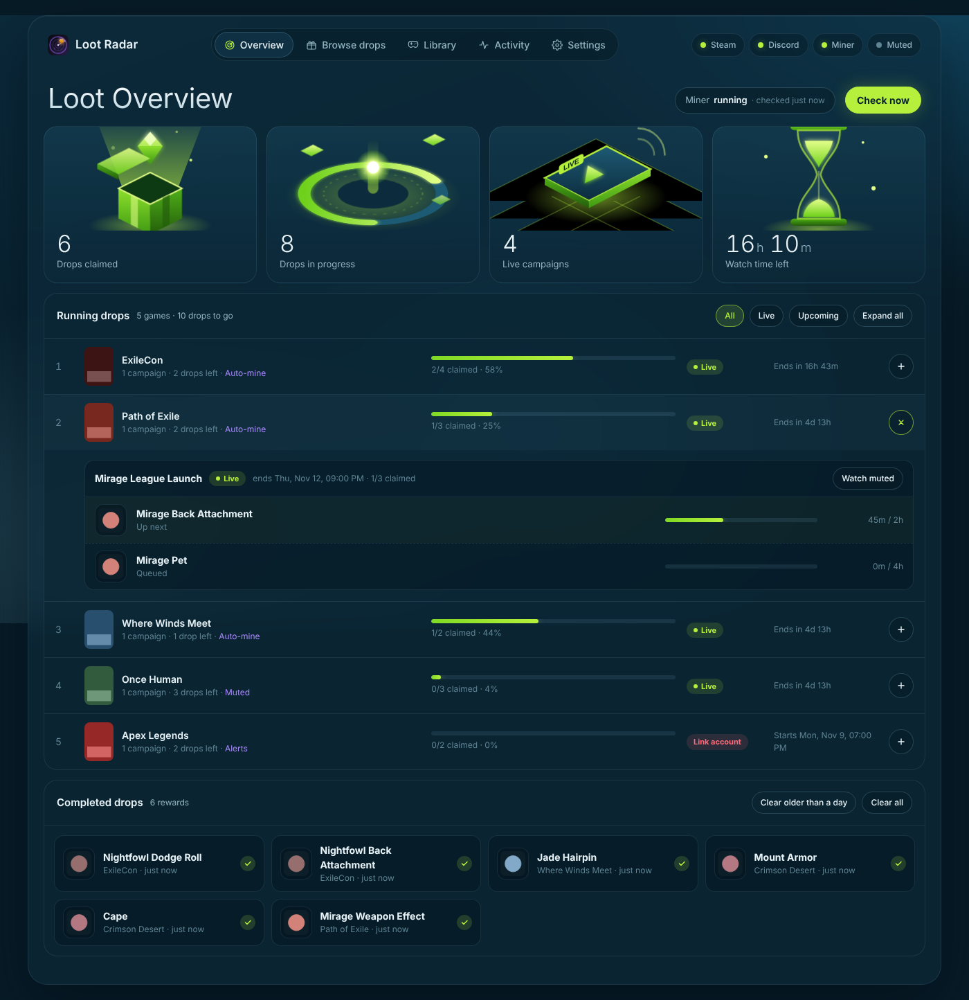

# Loot Radar

Never miss a Twitch drop for the games you actually play.

*Made by **solitary_samurai**.*

Loot Radar reads your Steam library and the games installed from your other launchers, watches the games you pick for Twitch drop campaigns and official Steam news, pings your Discord, and collects the drops for you in the background.

## What it does

| Feature | Details |
|---|---|
| Game library | Your Steam library (with hours played) plus games installed with Epic, EA app, Battle.net, Ubisoft Connect, Xbox, Rockstar, Riot and GOG (no logins needed). Set each game to **Off**, **Alerts**, **Auto-mine** or **Muted** |
| Any Twitch drop | **Browse drops** lists every campaign on Twitch, so you can add events and games that aren't on Steam (e.g. ExileCon) |
| Discord alerts | New drop campaigns (rewards, watch time, end date, account-link warning) and official Steam announcements |
| Auto-mine | Collects drops in the background with the built-in drop miner |
| Muted mode | Opens a real live stream, muted and at the lowest quality, and switches channel when it ends |
| Overview | Totals, the drop being mined right now with a live countdown, the channel and your channel points, collapsible running drops per game, and a completed-drops list you can clear |
| System tray | Runs quietly next to the clock: double-click the icon to open the dashboard, right-click to restart or quit |
| Updates | Checks GitHub every 6 hours for new versions of Loot Radar and the miner; one click to update |
| Memory guard | Restarts the miner if it ever uses too much memory |

## Install (Windows)

1. Click the green **Code** button on this page and choose **Download ZIP**.
2. Right-click the zip → **Extract All**, and put the folder somewhere permanent (e.g. `Documents\Loot Radar`).
3. Double-click **START.bat**. The first start installs everything it needs (including Python, if you don't have it) and opens the dashboard at <http://127.0.0.1:5577>. After that Loot Radar lives in the system tray (the ^ icons next to the clock); double-click its icon, or START.bat again, to reopen the dashboard.
4. Optional: double-click **Create Desktop Shortcut.bat** for a desktop icon.

## Set up (about 10 minutes, once)

Open **Settings** on the dashboard:

| Step | What to do |
|---|---|
| 1. Steam | Get a key at [steamcommunity.com/dev/apikey](https://steamcommunity.com/dev/apikey) (domain: `localhost`), paste it with your profile link. Your Steam profile's **Game details** must be **Public** |
| 2. Discord | In your server: channel ⚙️ → **Integrations → Webhooks → New Webhook → Copy Webhook URL**. Paste it and press **Send test** |
| 3. Drop miner | Press **Install miner**, then **Log the miner in to Twitch** and sign in |
| 4. Link games | Link your game accounts at [twitch.tv/drops/campaigns](https://www.twitch.tv/drops/campaigns), or drops never arrive |

Then go to **Library** or **Browse drops** and pick your games.

## Updating

Loot Radar tells you (on the dashboard and in Discord) when there's a new version of itself or of the miner. Press the button in **Settings → Updates** and it updates and restarts by itself. Your settings are kept.

## Good to know

- Right-click the tray icon → **Quit Loot Radar** to stop it (or **Quit Loot Radar and the miner**). **Show log** opens its log file.
- Something wrong? Run `START.bat console` from a command prompt to start it with the log visible.
- Everything personal (Steam key, Discord webhook, Twitch sign-in) stays on your PC in `app\data` and `%APPDATA%\TwitchDropsMiner`. It's never uploaded.
- Auto-mine uses [Twitch Drops Miner](https://github.com/SimpliAj/twitchdropsminer), which earns watch time without playing the video. That goes against Twitch's rules on cheating rewards, so there's some risk to the Twitch account you use with it. Muted mode really watches the stream.

## Credits

The drop miner is [Twitch Drops Miner](https://github.com/SimpliAj/twitchdropsminer) by SimpliAj, based on DevilXD's TwitchDropsMiner, used under the MIT licence. Loot Radar downloads it from its official GitHub releases; it isn't included in this repository.

## For maintainers: publishing an update

1. Make your changes.
2. Raise the number in `VERSION`: fixes and small tweaks `1.0.0` → `1.0.1`, a new feature → `1.1.0`, a big overhaul → `2.0.0`.
3. Add what changed to the top of `CHANGELOG.md`.
4. Commit, tag (`v1.0.1`) and push to `main`. Everyone's Loot Radar sees it within 6 hours.

The update source is set by `UPDATE_REPO` at the top of `app/updates.py`. See [CHANGELOG.md](CHANGELOG.md) for the version history.
